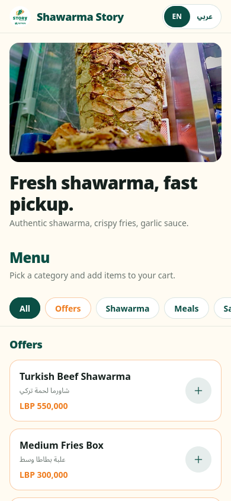
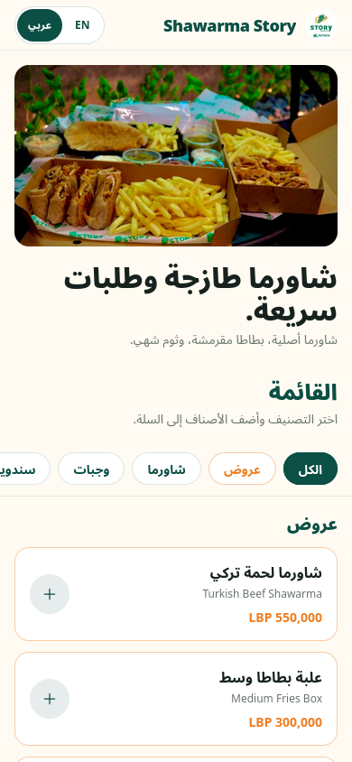
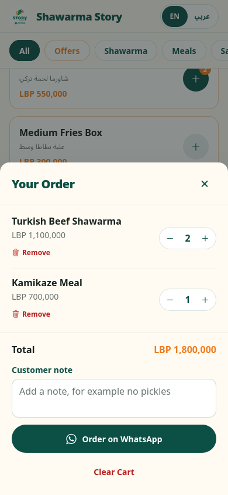
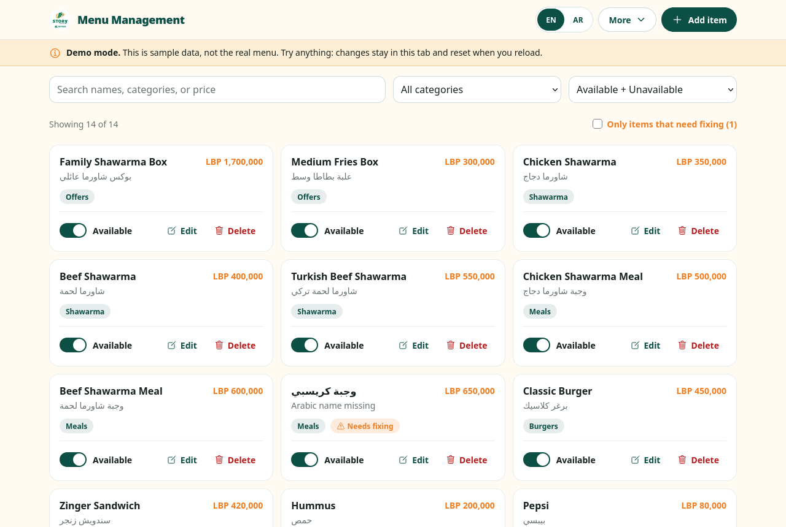
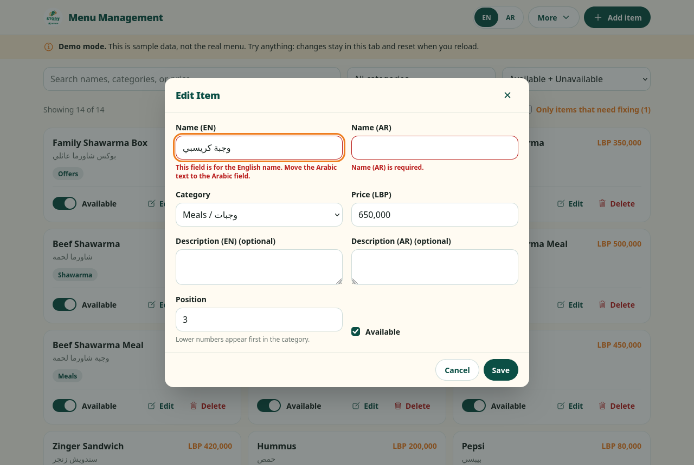

# Shawarma Story QR Menu


A live, mobile-first QR menu for Shawarma Story, a restaurant in Lebanon. Customers scan a QR code, browse the menu in English or Arabic, build an order, and send it to the restaurant on WhatsApp. Staff manage the menu from an admin panel backed by Firebase.

## Live Links

| | |
| --- | --- |
| **Live menu** | https://shawarmastory.com |
| **Admin demo** | https://shawarmastory.com/admin-demo |

The admin demo is the real admin panel running on sample data. There is no login, nothing is saved, and every change resets on reload. The production admin panel is private and protected by Firebase Auth and Firestore security rules.

## Screenshots

| Menu (mobile) | Arabic, right-to-left | Cart |
| --- | --- | --- |
|  |  |  |

| Admin dashboard | Item form with validation |
| --- | --- |
|  |  |

## Features

### Customer menu
- English and Arabic, with a full right-to-left layout for Arabic.
- Category bar that stays pinned while scrolling, with items grouped by category.
- Cart with quantities, a running total, and a note for the kitchen.
- Orders sent as a pre-filled WhatsApp message.
- Opening hours, Google Maps, and Instagram links.
- Carts saved in the browser are re-checked against the live menu, so an order never carries an old price or a removed item.
- Accessible: keyboard and screen-reader friendly dialogs, visible focus, and respect for reduced-motion settings.

### Admin panel
- Add, edit, and delete items, and switch availability on or off.
- Search, filter by category and availability.
- Rename or remove categories across all items in one atomic update.
- Validation that blocks Arabic text in the English name field (and the reverse), requires both names and a price, and asks for confirmation on prices that look entered in thousands.
- Customer-visible items with problems are flagged as "Needs fixing".

## Tech Stack

- React 19, React Router 7
- Vite 7
- Tailwind CSS 3
- Firebase Firestore, Auth, and Hosting
- React Icons
- Node's built-in test runner (`node --test`)

## How It Works

- **Data access goes through a small repository interface** (`list`, `add`, `update`, `updateMany`, `remove`). The real admin uses a Firestore implementation; the public demo uses an in-memory one that never imports Firebase. Both run the same `AdminDashboard` component.
- **Security is enforced on the server.** Firestore rules allow anyone to read the menu but only users listed in the `admins` collection to write. The admin route URL is not public, but the rules are what protect the data.
- **The admin code is lazy-loaded**, so customers never download the admin UI or Firebase Auth.

## Project Structure

```text
Story_Res_Menu/
  README.md
  docs/screenshots/
  frontend/
    .env.example
    firebase.json
    firestore.rules
    package.json
    src/
      App.jsx                  Routes (menu, admin, admin demo)
      firebase.js
      config/restaurantConfig.js
      pages/
        PublicMenuPage.jsx
        AdminMenuPage.jsx      Login + Firestore
        AdminDemoPage.jsx      Sample data, no login
      components/
        admin/                 AdminDashboard and its parts
        cart/
        common/
        layout/
        menu/
      services/
        firestoreMenuRepository.js
        memoryMenuRepository.js
      data/
        constants.js
        demoMenu.js
      i18n/
      utils/                   Cart, category, validation, WhatsApp helpers
```

## Local Development

### Prerequisites

- Node.js and npm
- Access to the Shawarma Story Firebase project (for the live menu and admin)

### Setup

```bash
cd frontend
npm install
cp .env.example .env
```

Fill in `.env` with the Firebase web app config:

```env
VITE_FIREBASE_API_KEY=your_firebase_api_key
VITE_FIREBASE_AUTH_DOMAIN=your_project.firebaseapp.com
VITE_FIREBASE_PROJECT_ID=your_project_id
VITE_FIREBASE_STORAGE_BUCKET=your_project.appspot.com
VITE_FIREBASE_MESSAGING_SENDER_ID=your_sender_id
VITE_FIREBASE_APP_ID=your_app_id
```

Never commit a real `.env` file.

### Scripts

| Command | What it does |
| --- | --- |
| `npm run dev` | Start the dev server (add `-- --host` to open it on your phone) |
| `npm test` | Run the unit tests |
| `npm run lint` | Run ESLint |
| `npm run build` | Build for production into `dist/` |
| `npm run preview` | Serve the production build locally |

### Deploy

```bash
npm run build
npx firebase-tools deploy --only hosting
```

Firestore rules are deployed separately with `--only firestore:rules`.

## Security Notes

- Do not commit `.env` files or any service account file.
- Admin writes are enforced by Firestore rules, not by hiding the admin URL.
- The admin demo uses only in-memory data and makes no Firebase requests.
- Firebase web config values identify the project; they are not secrets. Access is controlled by Auth and the security rules.

## Author

**Sami Farhat**

- GitHub: [SF-47](https://github.com/SF-47)
- LinkedIn: [www.linkedin.com/in/sami-farhat-46692641a](https://www.linkedin.com/in/sami-farhat-46692641a)
